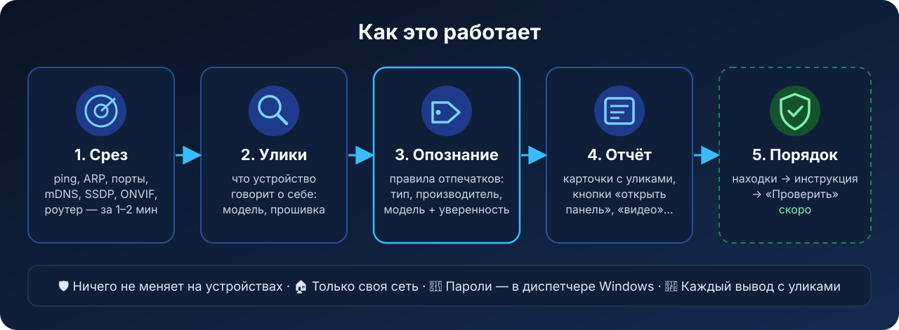
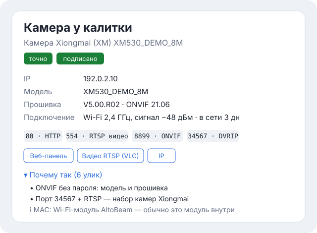

<p align="center">
  
</p>

<p align="center">
  
  
  
  
  
  <a href="LICENSE"></a>
</p>

**LanMap** заглядывает в домашнюю или небольшую офисную сеть и отвечает на простые вопросы: *что это за устройства, откуда я знаю, что это они, и всё ли с ними в порядке?*

Он не просто показывает список IP-адресов, а узнаёт устройства: «камера Xiongmai XM530, прошивка V5.00», «NAS Synology DS218j», «усилитель Wi-Fi TP-Link RE305». Для каждого вывода он показывает **улики**, на которых тот основан, и **уверенность**.

> 🛡 **LanMap ничего не меняет в сети.** Он только читает: никаких подборов паролей, эксплойтов и изменения настроек. Если что-то нужно исправить, программа даёт инструкцию, а исправляет человек.

## Как это работает

<p align="center">
  
</p>

| | Что делает | Откуда берёт |
|---|---|---|
| 🔭 **Срез** | Находит все устройства в своей подсети | ping, таблица соседей, ARP, TCP-порты |
| 🧾 **Улики** | Узнаёт, что устройство сообщает о себе само | UPnP, mDNS/Bonjour, ONVIF, WS-Discovery, NetBIOS, SMB, HTTP/TLS/SSH/RTSP-баннеры, роутер |
| 🔍 **Опознание** | Делает вывод: тип, производитель, модель, прошивка | [база отпечатков](lanmap/fingerprints/rules.json) + производитель по MAC (IEEE) |
| 📋 **Отчёт** | Карточки, поиск, фильтры, ссылки «открыть панель», «видео», «общие папки» | один HTML-файл, без интернета |
| ✅ **Порядок** | Чек-лист «порядок в сети: X из 9», находки безопасности → пошаговая инструкция → новый срез перепроверяет | цель — «экологичная сеть» E1–E9 |

## Как выглядит карточка



У каждого устройства есть:

- **название**: твоя подпись, подпись из роутера или то, что программа узнала сама;
- **уверенность**: точно / высокая / предположение / неизвестно;
- **подключение**: кабель или Wi-Fi, диапазон, сигнал, сколько устройство в сети;
- **открытые службы** и кнопки действий;
- **«Почему так»**: все улики и сработавшие правила. Противоречия не скрываются: если MAC говорит «AltoBeam», а ONVIF — «Xiongmai», программа покажет оба факта.

Ещё LanMap умеет:

- склеивать устройство с несколькими IP;
- распознавать камеры, которые выходят в сеть через соседей: подпись из роутера достаётся владельцу MAC (адрес получен по DHCP), а твоя подпись такой камеры (`sign <IP>`) запоминает адрес и не теряется, когда меняется MAC моста или серийник;
- показывать спящие устройства, которые помнит роутер;
- предупреждать о портах, открытых из интернета внутрь сети.

<br clear="right">

## Порядок в сети: чек-лист E1–E9

Цель — «экологичная сеть» из девяти критериев. В отчёте над «Безопасностью» стоит панель **«Порядок в сети: X из 9»**: строка на критерий, значок исхода и мини-полоска прогресса. Нажми на строку — увидишь, что мешает: находки (со ссылкой на карточку), незнакомые устройства, камеры в одной сети с ПК.

| | Критерий | Как проверяется |
|---|---|---|
| E1 | Все устройства опознаны и подписаны | Каждое отвечавшее устройство опознано уверенно или подписано (в реестре LanMap или в роутере) |
| E2 | Снаружи внутрь ничего не открыто | Находки про пробросы: UPnP и статические. VPN и другие осознанные двери — `finding set … accepted` |
| E3 | Камеры и умный дом отделены от ПК и NAS | По данным роутера: в какой сети (домашней, гостевой) каждое устройство. Изоляцию срез не проверяет, поэтому вывод «вероятно» |
| E4 | Нет устаревших и небезопасных протоколов | Находки: Telnet, ONVIF без пароля, SMB без подписи |
| E5 | Нет лишних служб | Находки: служебный порт камер, лишние службы NAS |
| E6 | Прошивки актуальны | Отмечаешь ты: `check set E6 done` |
| E7 | Отладочные входы выключены | Находки: ADB, служебные порты камер |
| E8 | Есть проверенная резервная копия | Отмечаешь ты: `check set E8 done` |
| E9 | Адреса важных устройств закреплены | Резервации DHCP из роутера для NAS, камер, принтеров и точек доступа |

У критерия четыре исхода: ✅ выполнен, ❌ не выполнен, ✏️ отмечаешь ты, ❔ нечем проверить (например, без данных роутера). «Нечем проверить» не засчитывается и не считается регрессом. Блок «Что изменилось» показывает «было X → стало Y» и какие критерии выполнились или снова перестали.

## Проверки безопасности

После каждого среза LanMap проверяет найденное и объясняет человеческим языком, **кто** может воспользоваться проблемой (🌐 любой из интернета или 🏠 любой внутри сети) и **что под угрозой**: файлы, видео с камер, вся сеть. К каждой находке есть пошаговая инструкция с разделами «что может сломаться» и «как вернуть». Сеть при этом не трогается: проверки смотрят только на уже собранный срез.

| Проверка | Что ищет | Приоритет |
|---|---|---|
| `UPNP_PORT_MAPPINGS` | Устройство само открыло себе порты из интернета через UPnP. Работает с любым роутером без пароля (см. ниже) | 🔴 П1 / 🟠 П2 за NAT провайдера |
| `STATIC_PORT_FORWARD` | Проброс порта, заведённый на роутере вручную (нужен модуль роутера). Осознанный, например VPN, — отметь «принята осознанно» | 🟠 П2 |
| `TELNET_OPEN` | Управление по Telnet, пароль идёт открытым текстом (на роутере — П1) | 🔴 П1 / 🟠 П2 |
| `CAMERA_XM_PORT` | Служебный порт 34567 камер на платах Xiongmai | 🟠 П2 |
| `CAMERA_ONVIF_ANON` | Камера без пароля рассказывает о себе по ONVIF | 🟠 П2 |
| `ADB_EXPOSED` | Отладка Android по сети (порт 5555) | 🟠 П2 |
| `NAS_EXTRA_SERVICES` | Лишние службы на хранилище: NFS, AFP, MySQL, FTP | 🟡 П3 |
| `SMB_SIGNING` | Общие папки без обязательной подписи SMB | 🟡 П3 |

В отчёте находки собраны в панели **«Безопасность»**. Карточка проверки — инфографика, а не абзац текста:

- **схема** «кто → куда»: например, 🌐 интернет → роутер ← NAS, на стрелках — сколько дверей открыто;
- **чем грозит** — цепочка из двух-трёх значков: подберут пароль → зашифруют файлы → выкуп;
- **план** — три коротких шага;
- **все затронутые устройства** списком. Нажми на устройство — откроется инструкция именно для него: куда зайти и что нажать (под производителя, если LanMap его знает, иначе общая), команда отметки статуса и кнопка перехода к плитке;
- «Подробнее» (свёрнуто): полный текст риска, «что может сломаться», «как вернуть», «как убедиться».

На плитках устройств стоит значок 🛡 с приоритетом, а блок «Что изменилось» показывает появившиеся и исчезнувшие находки.

Если проверить нечем (например, нет данных роутера), находка не считается ни «чистой», ни «новой». Так сравнение срезов не выдумывает изменений.

Отметки (`finding set`) запоминают адрес, MAC и серийный номер устройства. Если ключ устройства сменился (так бывает у камер, которые выходят в сеть через соседнюю и показывают её MAC), отметка находится по адресу, потом по серийнику, потом по MAC — и только когда совпадение однозначное. Поэтому важным устройствам стоит закрепить адреса (E9).

## Быстрый старт

Нужна Windows 10/11. Программа работает **только в Windows**: ping, ARP, таблица соседей, хранение паролей и запуск
программ идут через средства Windows. Версии для Linux и macOS пока нет.

### Без установки: портативная сборка

1. Скачай `LanMap-<версия>-win64.zip` со страницы [Releases](https://github.com/padrefalcon2011-code/lanMap/releases).
2. Распакуй куда угодно: на рабочий стол, в «Мои программы», на флешку. Внутри уже есть свой Python с python.org, ставить ничего не нужно.
3. Двойной щелчок по **`LanMap.bat`**. Откроется браузер, на первой странице три шага: скачать базу производителей, войти в роутер (по желанию), сделать первый срез.

Если Windows пишет «Система Windows защитила ваш компьютер»: «Подробнее» → «Выполнить в любом случае». Чтобы предупреждения не было, перед распаковкой открой у zip «Свойства» и нажми «Разблокировать».

Данные (срезы, подписи, отметки) лежат в папке `data` рядом с программой и переезжают вместе с ней. Новая версия: распакуй архив поверх старой папки, `data` останется. Если программа лежит в `Program Files` (туда пишет только администратор), данные будут в `%LOCALAPPDATA%\LanMap\data`. Где они сейчас — видно в окне `LanMap.bat` и в плашке «о срезе». Пароль роутера хранится в диспетчере учётных данных Windows, а не в папке: на другом компьютере вход в роутер надо сделать заново.

Собрать такой архив самому: `python tools/build_portable.py --check`. Скрипт скачает встраиваемый Python, сверит SHA256, положит в zip только файлы из git и прогонит тесты встроенным Python из папки с пробелами и кириллицей в пути.

### Из исходников

Нужен Python 3.12+. Ставить сторонние пакеты не нужно.

```bat
git clone https://github.com/padrefalcon2011-code/lanMap.git
cd lanMap
python -m lanmap interfaces          :: какая сеть будет сканироваться
python -m lanmap oui update          :: база производителей IEEE (скачивается целиком, твои MAC никуда не уходят)
python -m lanmap scan --open         :: срез за 1–2 минуты и отчёт в браузере
```

Лучше запускать из консоли администратора: так будут доступны все проверки.

### Веб-интерфейс

Проще всего — двойной щелчок по **`LanMap.bat`** в папке проекта: он попросит у Windows права администратора (с ними доступны все проверки; можно отказаться — запустится без них) и откроет браузер. Выключить — кнопка ⏻ справа в шапке: сервер остановится, вкладка и окно консоли закроются. То же из консоли:

```bat
python -m lanmap serve               :: отчёт с кнопками в браузере; остановить — Ctrl+C
```

Это тот же отчёт, но вместо «скопируй команду» в нём кнопки:

- **Найти устройство** в шапке: живой список устройств, обновляется каждые 2 секунды. Выключи камеру или Wi-Fi на телефоне — его плитка погаснет и всплывёт наверх, включи — загорится. Так видно, какое устройство в списке чем является, и его можно тут же подписать или помочь опознать. Новые адреса тоже всплывают. Опрос — ping по своей подсети и список клиентов роутера (если роутер подключён), только чтение; закрыл окно — опрос остановился;
- **⚙ Настройка** в шапке: база производителей (скачать или обновить), вход в роутер (форма; пароль уходит в диспетчер учётных данных Windows и никуда больше), паспорт роутера для заявки на модуль. Те же три шага — на первой странице, пока срезов нет;
- **⏻ Выключить** справа в шапке: сервер останавливается, вкладка браузера и окно `LanMap.bat` закрываются;
- **Срез** в шапке: новый срез сети, ход виден рядом с кнопкой, по готовности страница откроет новый отчёт;
- **Подписать** в раскрытой плитке: название, где стоит, чьё;
- **статус находки** у каждого устройства в карточке безопасности: открыта / в работе / исправлена / оставляю / не применимо, с причиной;
- **сделано / не сделано** у E6 и E8 в чек-листе, с заметкой.

Интерфейс открывается только на этом компьютере (адрес `127.0.0.1`). Вход — по ссылке с ключом, которую печатает `serve`: ключ новый при каждом запуске, без него страница и кнопки не отвечают. Кнопки пишут только в `data/`, на устройствах сети ничего не меняется. Порт по умолчанию 7480; если он занят, берётся любой свободный.

### Подключить роутер (по желанию)

С роутером карточки становятся богаче: появляются твои подписи, спящие устройства, тип подключения и пробросы портов. В веб-интерфейсе: ⚙ → «Роутер». Из консоли:

```bat
python -m lanmap router login        :: логин и пароль вводишь ты, пароль уходит в диспетчер учётных данных Windows
python -m lanmap router test         :: что роутер отдаёт для чтения
```

Совет: заведи на роутере отдельного пользователя с правами только на чтение.

### Спросить ИИ

Не понимаешь, что из находок страшно и что чинить первым? Нажми **«Спросить ИИ»** в шапке отчёта, скопируй текст и вставь его в чат с ИИ: ChatGPT, Claude, GigaChat, Алиса. Текст уже содержит просьбу: что опасно на самом деле, что исправить первым и как, по шагам для твоих моделей. LanMap сам ничего никуда не отправляет, только даёт текст для копирования.

В тексте вся картина: сеть, чек-лист, находки, пробросы портов и устройства. Производитель и модель — догадка LanMap без твоих подписей. Описания UPnP-пробросов (их пишут программы на устройствах, бывает с именем компьютера) добавляются только галочкой. Адреса, MAC, имена, подписи, имена сетей Wi-Fi и внешний адрес в текст не берутся; пробегись по нему глазами перед отправкой. Устройства заменены метками У1, У2…, одинаковыми по всему тексту, поэтому ИИ видит связи («проброс ведёт на У7, у У7 открыт Telnet»), но не твою сеть. Это всё же список слабых мест сети: в чат с ИИ — да, на открытый форум — лучше после исправления.

Если непонятно, что делать с конкретной находкой, пунктом чек-листа или пропущенной проверкой, открой её и нажми **«Разобрать с ИИ»** рядом. В промт попадут сведения для этого вопроса. ИИ получит просьбу свериться с документацией и предложить следующую проверку на чтение. Такие же подсказки есть для неполного среза, спорного адреса, настройки LanMap и входа в камеру. Учётные данные и заметки владельца в промты не попадают.

### Помочь опознать

Устройство не опозналось или опозналось неверно? Раскрой его плитку и нажми **«Помочь опознать»**: откроется обезличенный рассказ об устройстве и кнопка «Открыть заявку на GitHub» с уже заполненными уликами. Останется написать, что это на самом деле, и в базе отпечатков появится новое правило. Кнопка работает и в файле отчёта, без веб-интерфейса. В окне «Найти устройство» та же кнопка (?) есть у устройств, которые только что погасли, загорелись или появились впервые: выключил незнакомый гаджет, увидел, какой он, и сразу рассказал о нём. Для нового устройства, которого не было в срезе, текст короче: производитель по MAC и то, что знает роутер.

В рассказ попадают только улики для правила: тип по мнению LanMap, производитель по MAC, порты, заголовки веб-панели, службы mDNS и UPnP, модель из ONVIF. IP, MAC, твои подписи (в роутере и в LanMap), имена сетей Wi-Fi, серийные номера и имена экземпляров mDNS («iPhone Маши») в рассказ не берутся, а вывод LanMap в нём — собственная догадка программы, без твоих подписей. Заголовок веб-панели, realm, организация в сертификате и приветствия служб — хорошие улики, но в них бывает имя, которое ты сам дал устройству (например, NAS). Поэтому они добавляются отдельной галочкой «сырые строки», по умолчанию выключенной; прочитай текст перед отправкой. Имя, которое устройство само сообщает сети (например, `roborock-vacuum-a15`), часто лучшая улика, но в нём бывает имя человека: оно добавляется только галочкой, и ты видишь его в тексте до отправки.

## Поддерживаемые роутеры

| Роутер | Статус | Что читается |
|---|---|---|
| **Keenetic** (KeeneticOS 4.x–5.x) | ✅ работает | клиенты и их подписи, сегменты (домашняя/гостевая), Wi-Fi/кабель, сигнал, DHCP-имена и резервации, UPnP- и статические пробросы |
| Любой с UPnP | ✅ без пароля и без модуля | UPnP-пробросы и внешний адрес роутера (стандарт UPnP IGD) |
| Любой другой | 🔎 работает на одном сканировании | всё, кроме данных роутера |

**UPnP-пробросы без пароля.** Если на роутере включён UPnP, он сам по стандарту отдаёт список пробросов, которые раздал устройствам. LanMap читает этот список при каждом срезе:

- без входа в роутер;
- только запросами «Get…». Добавить или удалить проброс программа не может: любые другие запросы запрещены в коде.

Ещё роутер сообщает свой внешний адрес. Если адрес из сети провайдера (CGNAT, `100.64.0.0/10`) или частный, перед роутером стоит ещё один NAT. Тогда находка помечается «вероятно» и получает П2 вместо П1: снаружи эти двери, скорее всего, не видны. Если модуль роутера тоже подключён, его данные главнее, а совпадающие записи не дублируются.

**Хочешь поддержку своего роутера?** В веб-интерфейсе: ⚙ → «Паспорт роутера» → «Собрать». Или из консоли:

```bat
python -m lanmap router probe
```

Паспорт собирается без пароля, IP и MAC в нём вырезаны. Вставь его в [заявку на модуль](https://github.com/padrefalcon2011-code/lanMap/issues/new?template=router-module.yml). Модули пишутся по заявкам. Каждый модуль — это один файл-переводчик в [общий формат](lanmap/routers/__init__.py), поэтому новый роутер не требует переделки программы.

## Команды

| Команда | Что делает |
|---|---|
| `serve [--port N] [--no-open]` | Локальный веб-интерфейс: отчёт последнего среза с кнопками «Найти устройство», «Срез», «Подписать», статусы находок, отметки E6/E8 |
| `scan [--interface N] [--open]` | Новый срез в `data/snapshots/<время>/`: сырые улики, `devices.json`, `report.html`. Старые срезы не перезаписываются |
| `build [срез] [--compare срез] [--open]` | Пересобрать опознание и отчёт по сохранённому срезу без сканирования. Блок «Что изменилось» сравнивает с предыдущим срезом или с указанным в `--compare` |
| `finding list` | Находки безопасности последнего среза и их статусы |
| `finding set <ПРОВЕРКА> <IP\|MAC\|all> <статус> [--reason …]` | Отметить находку: `in_progress`, `fixed`, `accepted` (оставляю осознанно), `na`, `open`. Если исправленное вернётся в новом срезе, отчёт покажет регресс |
| `check list` | Чек-лист E1–E9 последнего среза |
| `check set <E6\|E8> <done\|open> [--note …]` | Отметить то, что программа проверить не может: прошивки обновлены (E6), резервная копия проверена (E8) |
| `router login \| test \| forget \| probe` | Вход в роутер (только чтение), проверка, удаление входа, паспорт для заявки |
| `sign <MAC или IP> --name "Камера у калитки" [--place …] [--owner …]` | Подписать устройство в реестре |
| `confirm <MAC или IP> …` | Подтвердить черновик реестра как есть |
| `oui update [--from файл]` | Обновить базу производителей по MAC |
| `finding recheck <ПРОВЕРКА> <IP\|MAC\|all>` | Перепроверить находку по сети, не делая нового среза |
| `link <IP> [--seconds 60]` | Тест связи: минуту ping до устройства и до роутера — медиана, потери и где теряется связь |
| `ai prompt <MAC или IP> [--names] [--raw]` | Промт «Разобрать с ИИ» для своего ИИ; `--raw` добавляет сырые строки устройства, `--names` — имя из DHCP/mDNS |

## Приватность

- Всё, что программа узнаёт о сети, лежит **только у тебя** в папке `data/` (рядом с программой или в `%LOCALAPPDATA%\LanMap\data`). Эта папка в `.gitignore`.
- База производителей скачивается целиком (IEEE, а если он не отдаёт — то же из зеркала Wireshark). Твои MAC никуда не уходят.
- Пароли хранятся в **диспетчере учётных данных Windows**, а не в файлах.
- Сканируется **только своя подсеть**: ни чужих адресов, ни интернета.
- Веб-интерфейс слушает только `127.0.0.1` и пускает по ключу из ссылки `serve`.
- Отчёт — локальный HTML-файл. Он содержит MAC-адреса и имена устройств, поэтому не публикуй его.
- Чтобы поделиться отчётом или спросить ИИ, есть обезличенные тексты: «Спросить ИИ» (весь отчёт) и «Помочь опознать» (одно устройство). LanMap их только показывает для копирования, сам ничего не отправляет.

## Дорожная карта

| Этап | Что появится | Статус |
|---|---|---|
| 0. Прототип | Срез, опознание по правилам, HTML-отчёт | ✅ |
| 1. Ядро | Модуль роутера, «что изменилось», проверки безопасности с инструкциями, чек-лист E1–E9 | 🚧 готовы модуль Keenetic, UPnP-пробросы с любого роутера без пароля, «что изменилось», 8 проверок безопасности и чек-лист E1–E9; впереди DHCP-отпечатки |
| 2. Интерфейс | Локальный веб-интерфейс: «Подписать», «Проверить», режим «выдерни вилку», стоп-кадры камер | 🚧 готовы `serve` с кнопками «Найти устройство» (живой список), «Срез», «Подписать», статусы находок и отметки E6/E8 |
| 3. ИИ | «Разобрать с ИИ» для неизвестных устройств, пополнение базы отпечатков | ⏳ |
| 4. Присмотр | Значок в трее, уведомление «в сети новое устройство» | ⏳ |
| 5. Раздача | Обезличенный экспорт, модули других роутеров, готовые сборки | 🚧 готова портативная сборка (zip со своим Python, `tools/build_portable.py`) |

Подробнее — в [концепции](docs/CONCEPT.md). Карта модулей и контракт среза для разработчика — в [docs/DEVELOPER.md](docs/DEVELOPER.md). Правила для ИИ-агентов, которые развивают проект, — в [AGENTS.md](AGENTS.md).

## Лицензия

[MIT](LICENSE): пользуйся, меняй и распространяй свободно, сохраняя упоминание автора. Программа предоставляется «как есть», без гарантий.
